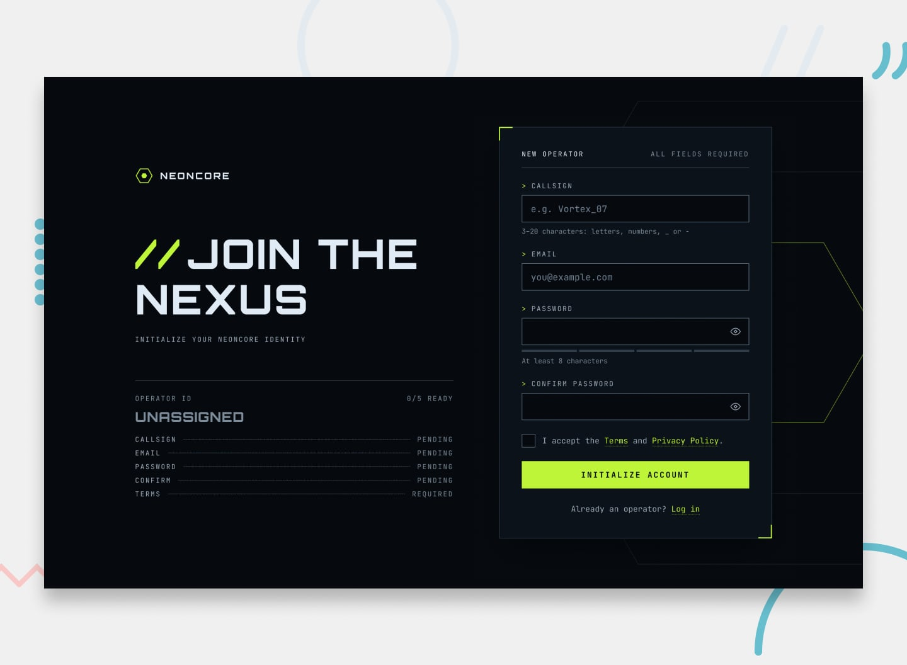

# Frontend Mentor - Gamer sign-up form

A responsive, neon-inspired registration experience for **NEONCORE**, built as a solution to Frontend Mentor's [Gamer sign-up form challenge](https://www.frontendmentor.io/challenges/gamer-sign-up-form).

The project focuses on a detailed form experience: live validation, password visibility and strength feedback, duplicate-account checks, and a success state. Registration data is stored in the browser for this challenge demo; there is no server or production authentication service.

## Table of contents

- [Overview](#overview)
  - [Challenge goals](#challenge-goals)
  - [Features](#features)
  - [Screenshot](#screenshot)
  - [Links](#links)
- [Getting started](#getting-started)
- [My process](#my-process)
  - [Built with](#built-with)
  - [Project structure](#project-structure)
  - [Form behavior and validation](#form-behavior-and-validation)
  - [What I learned](#what-i-learned)
  - [Challenges and solutions](#challenges-and-solutions)
  - [Continued development](#continued-development)
  - [Useful resources](#useful-resources)
  - [AI collaboration](#ai-collaboration)
- [Acknowledgments](#acknowledgments)
- [Author](#author)

## Overview

### Challenge goals

The challenge is to build a polished sign-up form that adapts to different screen sizes and gives users clear feedback while they enter their details. The interface should support keyboard use, communicate validation errors accessibly, and make the registration flow feel complete.

### Features

- Responsive desktop and mobile layouts.
- Callsign, email, password, password confirmation, and terms fields.
- Zod schema validation integrated with React Hook Form.
- Field-level feedback while editing, plus errors on invalid submission.
- Password show/hide controls for both password fields.
- A password strength meter that updates as the password changes.
- Cross-checking of password and confirmation values.
- Duplicate callsign and email checks against browser-persisted demo registrations.
- Disabled/loading submit state while the password is being hashed.
- Animated success panel after a valid registration.
- Desktop operator readout and readiness indicators.
- Keyboard-focus styles, input labels, error descriptions, and reduced-motion-aware form shake feedback.

### Screenshot



### Links

- Challenge: [Frontend Mentor - Gamer sign-up form](https://www.frontendmentor.io/challenges/gamer-sign-up-form)
- Solution: [View my Frontend Mentor solution](https://www.frontendmentor.io/solutions/gamer-form-with-vite-and-stunk-i92Hs575Dd)
- Live site: [gamer-form-repro.vercel.app](https://gamer-form-repro.vercel.app/)

## Getting started

### Prerequisites

- Node.js (a current LTS release is recommended).
- pnpm, used to install dependencies for this repository.

### Run locally

1. Clone this repository and move into its directory.
2. Install dependencies with `pnpm install`.
3. Start the Vite development server with `pnpm dev`.
4. Open the local URL printed in the terminal.

### Available scripts

| Command | Purpose |
| --- | --- |
| `pnpm dev` | Start the local Vite development server. |
| `pnpm build` | Run the TypeScript project build and create the production bundle. |
| `pnpm preview` | Preview the built bundle locally. |
| `pnpm lint` | Run ESLint across the project. |

## My process

### Built with

- React 19 and TypeScript
- Vite
- Tailwind CSS 4 with the Vite plugin
- React Hook Form for registration state and field handling
- Zod and `@hookform/resolvers` for schema validation
- Stunk with its persistence middleware for browser-side demo registration data
- Web Crypto API (`crypto.subtle` and `crypto.getRandomValues`) for salted PBKDF2 password hashing in the demo flow
- CSS Grid and Flexbox for layout
- Semantic form controls and responsive CSS

### Project structure

```text
src/
├── App.tsx                  # Form setup, schema resolver, and provider
├── index.css                # Theme tokens, global styles, and backdrop
├── components/
│   ├── form/                # Registration fields, feedback, and form card
│   ├── shared/              # Logo, status/readout, and success content
│   └── views/               # Desktop and mobile presentation areas
└── lib/
    ├── auth/                # Demo password hashing and duplicate checks
    ├── data/                # Password meter levels
    ├── schema/              # Zod registration schema
    ├── store/               # Persistent browser-side user list
    └── types/               # Shared TypeScript types
```

### Form behavior and validation

The form is created in `App.tsx` with `useForm` and provided to nested components through one `FormProvider`. The registration component consumes those methods with `useFormContext`, while smaller status components can subscribe to the values or state they need. The Zod resolver uses the same schema that defines the form's inferred TypeScript value type.

Current schema rules include:

- **Callsign:** 3–20 characters.
- **Email:** must match Zod's email format check.
- **Password:** at least 8 characters and must contain uppercase and lowercase letters plus a digit.
- **Confirmation:** required and must match the password.
- **Terms:** must be accepted.
- **Duplicate registration:** callsign and email are compared case-insensitively against records in the browser store.

After schema validation succeeds, the demo checks for duplicates. A new record is assigned a random salt and a PBKDF2/SHA-256 hash before being saved. The success panel then displays the registered callsign. The browser store is local to this device and browser profile, so it is useful for demonstrating UI behavior but does not create a real account that can be accessed from another device.

### What I learned

- **Sharing form state with context:** `FormProvider` makes one form instance available through nested components. Passing the full `useForm` return object avoids children receiving an incomplete set of methods.
- **Subscribing to form state:** React Hook Form exposes form state through subscriptions. Using `useFormState` and `useWatch` makes it clear which state a component needs and helps keep UI feedback reactive.
- **Keeping validation rules in one place:** the Zod schema drives runtime checks through the resolver and supplies the `FormValues` type, reducing drift between validation and TypeScript.
- **Modeling a multi-step UI:** the form and success content share a card and switch based on `isSubmitSuccessful`, keeping the completion state in the same visual location.
- **Making custom controls accessible:** explicit labels, `aria-invalid`, and `aria-describedby` connect fields to their validation messages; password visibility buttons have clear accessible names.
- **Handling passwords in a demo flow:** Web Crypto can generate a salt and derive a hash asynchronously, which also gives the submit button a real loading period to represent.

### Challenges and solutions

- **Form errors were not appearing in the UI at first.** The submit callback showed resolver errors, which confirmed validation itself was working. Subscribing to `formState` with React Hook Form's `useFormState` gives the form component reactive access to errors and submission state.
- **Typing the watched password value.** A form-wide type alone can represent any field value (including the boolean terms checkbox). Specifying the watched field name lets TypeScript infer the value as a string.
- **Avoiding misleading validation feedback.** Browser-native validation is disabled with `noValidate` so the custom Zod/React Hook Form messages can be presented consistently alongside the designed field states.

### Continued development

- Test the complete flow with keyboard-only navigation and screen readers, including how errors and the success state are announced.
- Consider using a dedicated live region to announce the count of invalid fields on submit.
- Add automated tests for schema rules, duplicate detection, password matching, and successful submission.
- If this becomes more than a frontend challenge demo, replace browser storage and client-side registration with a secure server-side authentication flow. The current local store is not an account backend.
- Revisit the password policy and strength meter together so the meter communicates advice consistently with the actual validation rules.

### Useful resources

- [React Hook Form: FormProvider](https://react-hook-form.com/docs/formprovider) - sharing form methods with nested components.
- [React Hook Form: useFormState](https://react-hook-form.com/docs/useformstate) - subscribing to form state such as errors and submission status.
- [React Hook Form: useWatch](https://react-hook-form.com/docs/usewatch) - subscribing to field values for reactive UI, such as the password meter.
- [Zod documentation](https://zod.dev/) - defining and composing validation schemas.
- [MDN: Web Crypto API](https://developer.mozilla.org/en-US/docs/Web/API/Web_Crypto_API) - browser cryptographic primitives used in the demonstration.
- [MDN: Constraint validation](https://developer.mozilla.org/en-US/docs/Web/HTML/Constraint_validation) - native form validation behavior and attributes.
- [MDN: `aria-describedby`](https://developer.mozilla.org/en-US/docs/Web/Accessibility/ARIA/Attributes/aria-describedby) - associating form controls with their hint or error text.

### AI collaboration

I used ChatGPT as a learning and debugging aid while building the project. I asked for help reasoning about the page background, the React Hook Form provider and validation flow, TypeScript inference for a watched field, and documentation structure. I used those explanations to inspect the code and make the implementation decisions in the repository.

AI suggestions were treated as guidance rather than assumed to be correct: I compared them with the installed library types and the behavior in the app. The README was drafted with AI assistance and should be kept in sync with future changes to the project.

## Acknowledgments

- Frontend Mentor for the challenge brief and design assets.
- The React Hook Form and Zod documentation for their guidance on form state and schema validation.

## Author

- Frontend Mentor solution: [gamer-form-with-vite-and-stunk](https://www.frontendmentor.io/solutions/gamer-form-with-vite-and-stunk-i92Hs575Dd)
- Live project: [gamer-form-repro.vercel.app](https://gamer-form-repro.vercel.app/)

